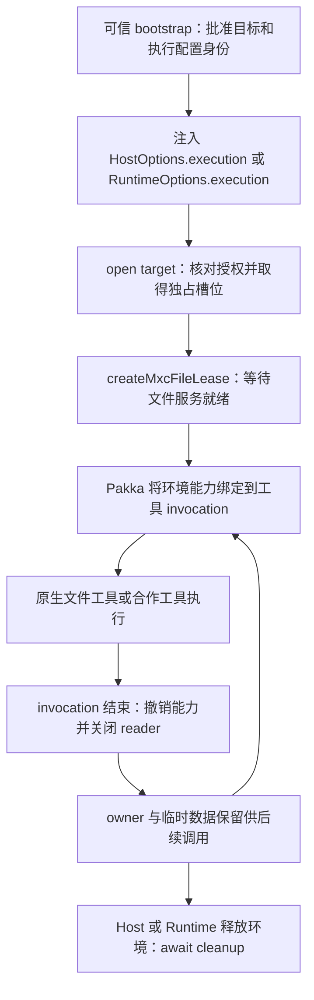

# MXC 文件服务使用指南

## 选择执行目标

`createMxcFileLease()` 返回一个文件 owner，负责单个 MXC 文件进程、打开的句柄和临时数据。它适用于可信宿主批准的文件工作区，可直接作为 Pakka 的部分 `ExecutionDriver`。

**先确认授权边界。** MXC 按路径授权，RW 根下的 hardlink 可能访问同一文件在禁止或只读根下的对象。工作树来源、宿主侧修改者和共享目录必须符合你的信任要求；直接路径拒绝不能证明对象别名隔离。本接口也不限制调用方绕过它直接使用宿主 API。

运行目标为 Windows x64、Node 24+，后端使用固定 MXC SDK 1.0.1 的 CLI。启动或身份检查失败即拒绝取得，运行时没有自动切换宿主 I/O 的路径。

## 配置并取得 owner

可直接运行的临时工作区例子见 [README](../../README.md)。应用集成时，先准备既有工作目录和可信状态父目录，再传入一个尚不存在的状态槽位：

```js
import { createMxcFileLease } from '@pakka/ei';

const lease = await createMxcFileLease({
  cwd: 'D:/work/project',
  stateDirectory: 'D:/trusted/ei-owners/owner-0001',
  readwritePaths: ['D:/work/project'],
  readonlyPaths: ['D:/reference'],
  deniedPaths: ['D:/private'],
});
```

这些示例目录须由宿主预先创建，只有 `owner-0001` 槽位由取得过程建立。`cwd` 不隐含授权；至少有一个明确的可读根覆盖它。应用可写根应与控制目录、环境代码及 Node 安装目录分离。不要把包含这些目录的整盘或共同父目录当作可写工作区。

参数、默认截止时间及方法签名见[契约](../state/mxc-files.md)和[公开类型](../../src/index.d.ts)。取得后的 `cwd` 和权限固定；迁移目标或改变权限应由宿主重新授权。

## 使用文件和 reader

```js
function value(result) {
  if (!result.ok) throw new Error(`${result.error.code}: ${result.error.message}`);
  return result.value;
}

try {
  value(await lease.writeFile('note.txt', 'content'));
  console.log(value(await lease.readTextFile('note.txt')));

  const reader = value(await lease.openBinaryReader('note.txt'));
  try {
    const bytes = value(await reader.read(0, 7));
    console.log(Buffer.from(bytes.base64, 'base64').toString('utf8'));
  } finally {
    await reader.close();
  }
} finally {
  await lease.cleanup();
}
```

reader 绑定已打开的对象，原路径改名或被替换不会重新绑定。临时文件和目录属于 owner，跨调用保留，正常关闭时释放。命令、watch、目录遍历和 text-line reader 没有对应方法；原子的 `noFollow: true` 请求明确返回 `not_supported`。

## 关闭、取消与故障

正常释放以 `await lease.cleanup()` 成功为判据。它停止接纳新操作，排空已接纳的完整操作，释放内部资源并确认进程退出。工作区中的业务文件保留，owner 的内部临时数据被清理。

| 观察                           | 处理                                                            |
| ------------------------------ | --------------------------------------------------------------- |
| 方法返回已知文件错误           | 根据 `error.code` 处理；不要把权限拒绝解释成文件不存在          |
| 发出前取消                     | 方法返回 `aborted`，该请求尚未执行                              |
| 发出后取消                     | 等待回执；已有写入可能部分完成，取消不表示回滚                  |
| 回复超时、失联、坏帧或未知错误 | 该 owner 拒绝后续工作，保留目标、槽位和证据；不自动重试         |
| `cleanup()` 拒绝               | 保留业务侧保留项与 owner 记录，核对效果、进程及持久记录后再裁定 |

文件方法的最后一个可选参数是 `AbortSignal`；省略中间的 options 时传 `undefined` 占位。单次取消不销毁其他调用共用的 worker。取得时可传独立的 signal；启动后取消需要等待明确收尾，不能凭 abort 请求认为进程已经退出。

状态槽位结构：

```text
owner-0001/
├── control/
│   ├── policy.json   # 生效策略，供可信宿主检查
│   └── record.json   # owner 身份、PID、取得/关闭记录
└── data/             # 环境内部临时数据
```

记录中的 `opening`、`ready` 或未知状态不表示已经释放。`status()` 是运行时诊断，不能代替 `cleanup()` 结果及持久记录。已有槽位会拒绝再次取得；应用负责持久登记目标和槽位的关系。旧 owner 的效果未裁定时，不要另建随机槽位绕过它。这里没有自动恢复或 unknown 回收命令。

## 接入 Pakka 的生命周期

宿主包需提供公开的 `ExecutionConfiguration`、`ExecutionDriver` 和 `executionFor(scope)` 接缝；具体已验证构建见[固定消费记录](../verification/persistent-files-2026-11-05-final/README.md)。环境核心本身不依赖 Pakka 包。



1. 在可信 bootstrap 中提供稳定的执行配置 `id` 和 `open(target)`。宿主持久分配状态槽位并批准目标；不要把目标传入的 cwd 自动当作授权。
2. `open` 返回文件 owner。其 `id: "node:local"` 是文件名字空间，区别于配置身份和 `leaseId`；多个 owner 可以访问同一文件名字空间。
3. `tools` 显式选择 `read`、`write`、`edit`。合作工具通过 `executionFor(scope)` 获取当前调用的能力，而不是保存 owner 本身。
4. Pakka 管理调用范围及环境缓存；工具结束释放 invocation reader，Host/Runtime 释放环境时调用 owner 的 cleanup。修改权限或环境语义时，调整宿主执行配置身份。

Pakka 的这个 `open` 接口没有初始化取消参数，缓存环境的健康变化也不会自动回接每次模型请求门禁。owner 的 unknown 会拒绝实际文件操作，但这不等于之后所有 HTTP 必然为零。模型权限、业务回执与跨重启的 owner 裁定仍是宿主职责。

Pakka 对缺失文件方法返回 `not_supported`，对缺失命令返回 `shell_unavailable`。因此选择原生 `read` 并不补齐目录读取等缺失方法。可运行的安装消费检查见 [`test/consumers/pakka.mjs`](../../test/consumers/pakka.mjs)，运行方式见[开发指南](DEVELOPMENT.md)。
