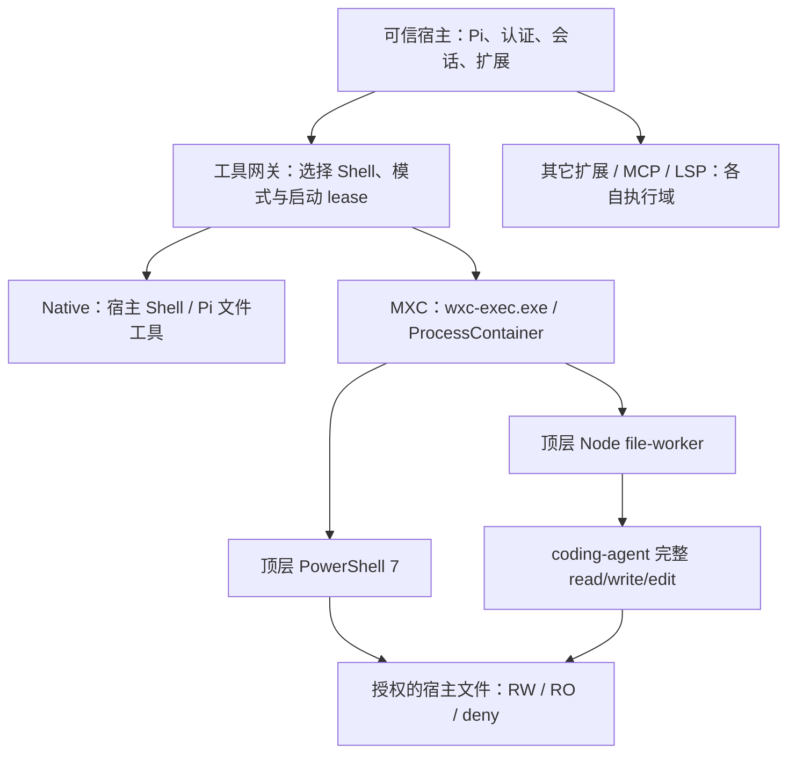

# Pi Tool Gateway：Windows 执行隔离调查

调查日期：2026-11-04。本文保存固定版本的源码观察、独立复跑与候选接入分析，不是 pakka-ei 已采用的 sandbox 规格。

## 结论

`pi-tool-gateway` 是已经具备真实 MXC 执行与权限回归的 **pi-coding-agent 工具网关**，适合作为 pakka-ei Windows 执行层的实现参考，但不能直接等同于 pi-durable 的评估执行环境。

关键差别：

1. 它只约束经过网关的工具执行，Pi、可信扩展、MCP、LSP 等宿主代码仍在各自权限域中。
2. 可用性检查失败会回退 Native，恢复宿主权限。若某次评估要求隔离，接入端必须在产生效果前拒绝这种执行；提示或事后标记不足以提供保护。
3. 每次文件操作启动一个 MXC Node worker，并加载 coding-agent 文件工具。独立小样本中，微小文件 read/write 各约 2.1 秒；复用其语义有明显启动成本。
4. 会话授权和后台任务注册表在内存中。网关没有提供评估运行记录、跨进程效果核对或 pi-durable 恢复协议。
5. 所核对的 pi-durable 已有公开 `ExecutionEnv` 接入面，应优先围绕它比较适配成本，而不是模拟 coding-agent 的 `ExtensionAPI` 和 TUI。

第 2、3、4、5 点是接入设计条件，不是对原项目已声明用途的缺陷认定。

## 来源与版本

| 材料 | 本次固定版本与用途 |
| --- | --- |
| [pi-tool-gateway](https://github.com/mapleluvr/pi-tool-gateway/tree/638cdecdeae7758f334a2a59e76f6c2f03f85efd) | `main` / `638cdecdeae7758f334a2a59e76f6c2f03f85efd`，版本 `0.1.0`，2026-11-04 的初始公开快照 |
| [包清单](https://github.com/mapleluvr/pi-tool-gateway/blob/638cdecdeae7758f334a2a59e76f6c2f03f85efd/package.json) | 开发 Pi `1.4.0`、TypeBox `1.3.27`、TypeScript `5.9.3`；可选 `@microsoft/mxc-sdk` 固定 `1.0.1` |
| [原项目验证记录](https://github.com/mapleluvr/pi-tool-gateway/blob/638cdecdeae7758f334a2a59e76f6c2f03f85efd/docs/validation/publication.md) | 作者记录 172 项通过；这是上游证据，本次结果单独列于下文 |
| [Pakka 对照快照](https://github.com/mapleluvr/pakka/tree/547c4968b9414ecff774edb7071687539895e8e8) | 本地干净 `main` 的固定提交；仅用于核对 MAS 包与 Durable 依赖，不宣称是 EI 最终依赖版本 |
| [Durable 固定归档](https://github.com/mapleluvr/pakka/blob/547c4968b9414ecff774edb7071687539895e8e8/packages/agent/vendor/earendil-works-pi-durable-1.4.0-pakka.1.tgz) | 从归档读取完整 README、公开 exports 与 `env/index.d.ts`；基线是 Pi `1.4.0`，上游提交 `4a080252f06caf63a525d7873c5d94d3c23887e0` |

gateway 是 MIT；其 [NOTICE](https://github.com/mapleluvr/pi-tool-gateway/blob/638cdecdeae7758f334a2a59e76f6c2f03f85efd/NOTICE)说明 Shell／后台实现来自 `pi-bash-bg`，MXC 资源遵循 Microsoft 依赖自身许可证。复制或抽取代码时需保留适用的来源与许可；本次没有复制运行代码到 pakka-ei 的跟踪文件中。

gateway 的包以 `pi.extensions: ["./index.ts"]` 供 coding-agent 加载，peer 范围为 `*`；开发锁只证明固定 cohort 的检查范围，不能据此推导任意 Pi 版本兼容。包中没有声明 pi-durable 依赖，也没有给出稳定的 headless executor 公共 API 契约。

## 实现路径



- [`index.ts`](https://github.com/mapleluvr/pi-tool-gateway/blob/638cdecdeae7758f334a2a59e76f6c2f03f85efd/index.ts)注册 `bash`、`bg_run/status/logs/kill/join` 和 Shell 选择，后台注册表按需创建。
- [`src/gateway.ts`](https://github.com/mapleluvr/pi-tool-gateway/blob/638cdecdeae7758f334a2a59e76f6c2f03f85efd/src/gateway.ts#L190-L275)按调用取得执行 lease；启用时替换文件工具，并路由已激活的 `powershell`。`user_bash` 接管用户 `!` / `!!`。
- [`src/mxc/mode.ts`](https://github.com/mapleluvr/pi-tool-gateway/blob/638cdecdeae7758f334a2a59e76f6c2f03f85efd/src/mxc/mode.ts)维护 `inactive/checking/ready/fallback`，共享并发自检，以 generation 拒绝旧检查结果覆盖新配置。
- [`src/mxc/runtime.ts`](https://github.com/mapleluvr/pi-tool-gateway/blob/638cdecdeae7758f334a2a59e76f6c2f03f85efd/src/mxc/runtime.ts)负责策略、自检、进程、私有材料与清理。
- [`src/mxc/file-worker.mjs`](https://github.com/mapleluvr/pi-tool-gateway/blob/638cdecdeae7758f334a2a59e76f6c2f03f85efd/src/mxc/file-worker.mjs)在容器中加载 Pi 文件工具，执行目标路径解析和读写；宿主不先按模型给出的文件目标进行真实文件操作。网关的 `fileTail` 串行化完整文件调用，补足不同单次 worker 之间的 mutation 顺序。

### 自检和策略

MXC 要求 Windows 和 PowerShell 7，Shell 自动选择的其它候选仍走 Native。它不是 VM 镜像方案，而是通过 MXC ProcessContainer 运行顶层进程。

[`check()`](https://github.com/mapleluvr/pi-tool-gateway/blob/638cdecdeae7758f334a2a59e76f6c2f03f85efd/src/mxc/runtime.ts#L300-L323)不仅判断 EXE 是否存在，还要求 `base-container`、显式 deny/enumeration、native capture 和无需宿主 DACL augmentation；随后实际验证策略、执行 PowerShell，再执行完整 Pi 文件 worker。源码自检不负责给宿主补 ACL 或开启系统能力。

有效策略包括：工作区及额外授权目录 RW，可信运行资源和指定参考目录 RO，明确的 deny 路径，以及每作业私有 RW 目录。新建私有 HOME/TEMP，子进程只继承明确白名单环境；网络默认拒绝出入站和 host-loopback，剪贴板、输入注入与系统设置受到限制。

[`hardlinks.ts`](https://github.com/mapleluvr/pi-tool-gateway/blob/638cdecdeae7758f334a2a59e76f6c2f03f85efd/src/mxc/hardlinks.ts)核对 canonical 路径、保护资源 symlink 与文件 ID；各 RW 卷中存在保护文件的硬链接别名时使配置不可用。deny 目标不能与可重命名的 RW 根重叠，不能把答案文件简单放在整个 RW 工作区中再期待一条局部 deny 生效。

成功的布局审计按 runtime 缓存。它约束受控工作负载，不保护自己免受后续可信宿主修改文件别名或运行代码；重新检测使用 `/mxc retry`。

### 失败、授权与后台寿命

| 条件 | 源码行为 | 对评估接入的影响 |
| --- | --- | --- |
| 执行前 MXC 不可用 | 返回 Native lease 并提示，原命令可在宿主执行一次 | 强制隔离用例需要执行前 gate；单次预检后放任后续调用仍不够 |
| 普通权限拒绝 | 该调用失败，保持 MXC | 适合独立记录预期拒绝与意外基础设施错误 |
| 已执行或效果未知后发生 runtime 错误 | 当次不在 Native 重放；后续模式可能 fallback | 保留已知／未知效果，并重新约束下一次调用 |
| 更改模式、allow/revoke | 新调用采用新 lease；旧调用及后台任务保留原权限 | revoke 不等于终止旧任务，也不能收回已复制数据 |
| 会话替换／reload | 内存授权重新建立 | 恢复时需要重新准入，不能从旧描述性路径直接恢复授权 |
| MXC `bg_kill` | 请求取消，等待执行器退出确认；预算耗尽可仍为 running | 区分取消请求、进程退出、工作区收尾 |

[`registry.ts`](https://github.com/mapleluvr/pi-tool-gateway/blob/638cdecdeae7758f334a2a59e76f6c2f03f85efd/src/registry.ts)的 task Map 是内存结构，日志在宿主临时目录。Native kill 保留旧实现的超时结算逻辑，不能套用 MXC 的确认强度。`bash.timeout` 是前台等待预算，不是任务截止时间；源码没有形成评估级 CPU、内存、磁盘或总时长配额契约。

`policyId` 是若干路径、Shell 和运行位置的配置哈希截断，并非工作区内容、运行器二进制或完整评估环境的可复现摘要。

## 本次独立运行结果

环境：Windows `10.0.26200.0`、Node `24.15.0`（libuv `1.51.0`）、PowerShell `7.6.9`、npm `11.12.1`。来源 checkout 保持未修改。安装使用锁文件且跳过 lifecycle scripts；测试使用隔离 HOME、agent 配置与夹具，实际使用 MXC，没有真实模型调用。

| 检查 | 结果与范围 |
| --- | --- |
| `npm ci --ignore-scripts --no-audit --fund=false` | 成功，安装 127 个包 |
| `npm run typecheck` | 通过 |
| `npm test` | 172 项：**169 通过、3 失败、0 跳过、0 取消**；总耗时 228128 ms |
| `npm pack --dry-run --ignore-scripts --json` | 成功；19 个 payload 文件，压缩 38764 bytes，展开 134306 bytes；不是发布 |
| 测试后 `git status --porcelain` | 来源跟踪文件无修改 |

通过项目包括实际 read/write/edit、Unicode 与图片结果、RO/deny 宿主哨兵、junction 越界拒绝、可达 loopback 的 Native/MXC 对照、硬链接保护、取消前后 PID 对照、额外目录及第二卷、清理失败、真实 Pi loader 和 CLI/RPC 路径。具体覆盖取自该固定版本测试，不扩张为整个宿主隔离或任意恶意代码安全证明。

### 三个失败的边界

| 测试 | 失败位置 |
| --- | --- |
| protected reference symlink into RW — existing | `tests/mxc-hardlinks.test.ts:82` |
| protected reference symlink into RW — dangling | `tests/mxc-hardlinks.test.ts:82` |
| protected symlink into an extra RW root | `tests/mxc-paths.test.ts:84` |

均在宿主 `fs.promises.symlink(..., "file")` 构造夹具时返回 `EPERM`，尚未执行对应的 `runtime.check()` 断言。

不加载 gateway 的独立对照：在本地临时目录中创建普通目标文件／目录，依次调用 Node 的 file-existing symlink、file-dangling symlink、directory symlink、junction 和 hardlink，最后清理。结果前三者都为 `EPERM`，junction 和 hardlink 成功。本次进程权限列表没有 `SeCreateSymbolicLinkPrivilege`；开发者模式的 `AllowDevelopmentWithoutDevLicense` 注册表值未找到。

这些证据把失败定位到本次宿主／进程的 symlink 创建条件，未进一步在改变权限、开发者模式或 Node 版本后做因果对照。三个保护断言仍未完成；没有提升权限、修改系统设置或修改测试跳过它们。

### 顺序小样本耗时

全量测试结束后，使用同一真实 fixture、同一通过自检的 runtime，顺序执行每组 5 次。Shell 命令为 `Write-Output 'MEASURE_ONLY'`，文件内容为 `MEASURE_ONLY\n`。核对 Shell exit/output 和 read 返回内容；write Promise 成功返回。测量覆盖执行体及私有材料正常清理，不经过模型、MAS、TUI、前台转后台或结果持久化。

| 操作 | 五次样本（ms） | 中位数 |
| --- | --- | --- |
| Native PowerShell | 470.8 / 465.8 / 450.4 / 449.8 / 451.1 | 451.1 ms |
| MXC PowerShell | 863.9 / 846.4 / 861.3 / 821.4 / 857.3 | 857.3 ms |
| MXC Pi read | 2153.9 / 2130.1 / 2158.5 / 2131.3 / 2138.4 | 2138.4 ms |
| MXC Pi write | 2094.1 / 2078.4 / 2126.7 / 2048.7 / 2104.8 | 2094.1 ms |

首次 `createMxcRuntime()` 加 `check()` 为 4143.1 ms。它发生在本轮其他测试之后，不代表系统冷启动；没有跨机器、随机交错顺序、长时间负载、RSS 或 CPU 成本对照。结论仅为：在此机器与此微小负载下，单次完整文件 worker 的启动开销值得在轻量化设计中实际比较。

### 复跑方法

在一个可信源码目录取得固定版本；评估工作区应与源码／依赖和私有控制材料分离。以下命令仅重跑来源项目的测试，不启动 pakka-ei：

```powershell
git clone https://github.com/mapleluvr/pi-tool-gateway.git pi-tool-gateway
Set-Location pi-tool-gateway
git checkout --detach 638cdecdeae7758f334a2a59e76f6c2f03f85efd
npm ci --ignore-scripts --no-audit --fund=false

# 每个新 PowerShell 进程重新设置；用真实系统临时路径保留第二卷测试条件。
$realTemp = node -e "process.stdout.write(require('node:fs').realpathSync.native(require('node:os').tmpdir()))"
$homeDir = Join-Path $PWD 'docs\.temp\validation-home'
New-Item -ItemType Directory -Force $homeDir, "$homeDir\agent", "$homeDir\AppData\Local", "$homeDir\AppData\Roaming" | Out-Null
$env:HOME = $homeDir
$env:USERPROFILE = $homeDir
$env:LOCALAPPDATA = "$homeDir\AppData\Local"
$env:APPDATA = "$homeDir\AppData\Roaming"
$env:PI_CODING_AGENT_DIR = "$homeDir\agent"
$env:TEMP = $realTemp
$env:TMP = $realTemp
$env:PI_OFFLINE = '1'
$env:PI_SKIP_VERSION_CHECK = '1'
Get-ChildItem Env: | Where-Object Name -match 'API.?KEY|TOKEN|SECRET|PASSWORD' |
    ForEach-Object { Remove-Item "Env:$($_.Name)" }

npm run typecheck
npm test
npm pack --dry-run --ignore-scripts --json
```

完整用例要求可用的 MXC、PowerShell 7、文件 symlink 创建条件以及 cwd／临时目录分处两个真实文件系统卷。缺少条件时保留实际失败；不要将 Native fallback 或平台跳过计为隔离通过。环境变量名过滤仅是额外保护，实际 Pi smoke 测试另用显式白名单环境和独立 agent 配置。

本地原始输出位于 `docs/.temp/evidence/`；本文保存了关键方法、计数、错误与样本，即使忽略目录清理后仍可追查结论。

## pi-durable 与 pakka-mas 对照

### Durable 的公开执行面

在所核对的 `1.4.0-pakka.1` 归档中：

- `HarnessOptions.env` 为工具、section 和任务运行提供 `ExecutionEnv`，可按 Conversation ID、cwd 与已提交状态选择环境。
- `ExecutionEnv` 同时包含文件系统和 Shell；覆盖 binary/line/dir reader、write/append/rename/remove、canonicalPath、临时文件、watch、cleanup，以及 string／argv 两种 exec。
- exec 的输出携带 stdout/stderr 来源，错误使用 `Result` 与结构化错误码，取消使用 Chord Context。
- `defineTool()` 的结果使用 `output/structuredOutput/details`，不同于 coding-agent 的 `content/structuredContent/details`。
- 工具执行意图先持久化；跨重启重跑由 `replay` 契约控制。完成的会话提交不能替代外部文件或进程效果的核对。
- 自定义环境可使用公开的 `registerEnvConformance()`。通过这些契约检查也仍需单独的真实 Windows 权限测试。

因此，现有 `createMxcRuntime().executeFile("read"|"write"|"edit", ...)` 不是完整 `ExecutionEnv`。它执行的是完整 coding-agent 工具，不是环境层文件原语；当前 `BackendExecutor` 也合并 Shell 输出流，只接受命令字符串。直接包一层类型转换会漏掉实质契约。

可比较的两条候选路线：

1. **MXC-backed ExecutionEnv**：复用策略与进程隔离经验，实现 Durable 环境契约，让 Durable 自身的工具留在原生调度下。需专门处理文件 handle 生命周期、同文件 mutation 顺序、跨调用临时文件及错误映射。
2. **Durable 专用工具适配**：明确只支持选定工具，用 `defineTool` 接入现有完整 worker。初期实现面可能较小，但继续依赖 coding-agent，且承担参数／结果适配与文件 worker 成本。

本次优先建议试写第一条路线的最小可运行切片，以实际用例和契约测试决定；尚未采用、实现或宣称能够低成本完整兼容。

### MAS 的职责与发行身份

所核对的 [MAS 包](https://github.com/mapleluvr/pakka/blob/547c4968b9414ecff774edb7071687539895e8e8/packages/mas/package.json)名为 `@pakka/mas`、版本 `0.4.0`、`private: true`，peer 为 `@pakka/agent` `0.7.0`。用户要求中的“依赖 pakka-mas”已进入产品预期，但不能据此直接写出可从 npm 安装的 `pakka-mas` 依赖坐标；独立发布身份及所用版本仍需对齐。

源码的 `createMas({ runtime, ... })` 经 Runtime catalog 管理成员及授权；`MasClient` 提供 send/reply/receipt/wait、spawn、abort/retire 等绑定操作，原生调用用 `forInvocation()` 绑定权限。它适合组织被测 Agent、评审 Agent 和编排者，但成员授权不是操作系统 sandbox，投递回执也不是评分或工具外部效果完成的凭证。

## 后续设计入口

以下是调查派生的问题和建议，等待具体评估需求确定，而非本轮初始化自动新增的产品承诺：

1. **先给出一条真实评估用例**：被测对象是 prompt/skill、Agent 协作还是可执行扩展代码？输入、产物和评分由谁提供，如何判断一次执行完成？不可信扩展若直接加载到宿主，当前工具网关不覆盖该威胁面。
2. **明确执行权限**：是否所有评估都强制隔离？哪些阶段可联网？建议将可信编排、provider 凭据、权威记录及评分依据与被测 RW 工作区分开；工具离线不妨碍宿主自身调用 provider，但联网型任务需要另外定义可用环境。
3. **对齐发行版本**：确认 EI 消费的 pakka-mas / agent / Durable 版本及公开入口；再决定复用 gateway 代码、推动抽取独立核心，还是只借鉴实现。保留来源和许可证。
4. **最小接入试验**：一个被测 Agent、一个确定性判定器、一个独立工作区；贯通准入、真实工具效果、结果采集与清理。比较调用成本，同时核对不可用时无 Native 执行、正常拒绝、取消退出确认、重开后的未知效果处理。
5. **再发展多 Agent 评估**：用 MAS 明确投递身份与协作关系，用 Durable 已有持久机制记录所需事实；外部进程和文件效果按自己的身份核对，避免把任意命令声明为安全重放。

本轮没有设计评估数据库表、指标格式、CLI 或完整调度器。下一轮可从上述用例继续，将得到用户认可的关系写入 `docs/state/`，再按需求实现。
